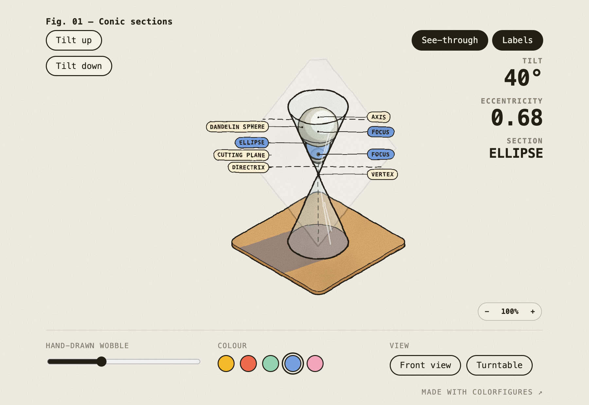

# Conic sections

A clear double cone cut by a tilting plane, drawn by hand in code. Tilt the plane to watch the cut go from a circle to an ellipse, a parabola and a hyperbola. Turn on See-through to see the Dandelin spheres, the foci and the directrix lines.

Open it: https://ibeez.github.io/conic-sections/

Drag to turn the cone, and use the zoom chip to look closer. It works on a phone too.

Made with [Colorfigures](https://april-zhu.com/colorfigures).

